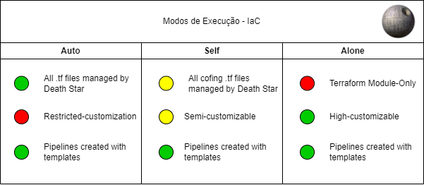

<!--
SPDX-FileCopyrightText: 2025 Suzano S.A.

SPDX-License-Identifier: MIT
-->

# sz-deathStar-infra

Infrastructure automation templates and Terraform helper pipelines for Google Cloud Platform (GCP).

This repository provides:

- A set of reusable Terraform configurations and module layouts under `terraform/`.
- CI/CD pipeline templates and validation jobs under `pipelines/`.
- Documentation and examples under `docs/` (see `docs/en` and `docs/en/terraform/gcp`).

You can use this project as a central infrastructure template repository that your application repositories reference and reuse from their pipelines.

## Quick links

- Docs index: `docs/en/index.md`
- Terraform overview: `docs/en/terraform/index.md`
- Pipeline templates: `pipelines/templates`
- Build/validation examples: `pipelines/build_validation`

## Execution modes

`sz-deathStar-infra` supports three main operation modes that control how your repository and the centralized infra templates are combined:

- [Auto](docs/en/modes/auto.md): Use DeathStar-managed JSON + standard Terraform resources. Fast start for low-to-medium complexity projects.
- [Self](docs/en/modes/self.md): Use DeathStar-managed JSON plus optional `self_*.tf` files from the application repo (good for medium complexity).
- [Alone](docs/en/modes/alone.md): The application repo provides full Terraform configs/modules; DeathStar templates are not used to generate resources (for high complexity projects).

See `docs/en/index.md` and `docs/en/deployment.md` for details and usage patterns.



## Getting started (CI integration)

1. Add the infrastructure repository as a resource in your pipeline YAML and point to a stable tag or branch:

```yaml
resources:
  repositories:
    - repository: sz-deathStar-infra
      type: git
      name: Nucleo_Digital/sz-deathStar-infra
      ref: v_0.3.0
```

2. Include the pipeline template you need and pass the required parameters, for example:

```yaml
stages:
  - template: pipelines/templates/terraform_w_vars.yaml@sz-deathStar-infra
    parameters:
      project_prefix: my-project-prefix
      TF_VAR_ENVIRONMENT: ${{ variables.TF_VAR_ENVIRONMENT }}
```

Refer to `pipelines/default.yaml` and the `pipelines/templates/` folder for additional template options and parameter descriptions.

## Local testing of Terraform

To test Terraform locally (recommended on Linux/WSL / macOS):

1. Install Terraform, WSL (if on Windows), and Docker (if modules require containerized tools).
2. From your repository root (where a `terraform/` directory exists or is symlinked), run:

```bash
cd terraform
terraform init
terraform plan
terraform apply
```

Example variables you may set (as environment variables or in `terraform.tfvars`):

```text
TF_VAR_AZURE_DEVOPS_REPO = sz-deathstar-example-feat
TF_VAR_ENVIRONMENT = dev
TF_VAR_GCP_PROJECT = sz-snop-dev
TF_VAR_GCP_REGION = southamerica-east1
```

To remove or import resources in the state:

```bash
terraform state rm google_storage_bucket.buckets["sz-snop-__env__-docs.json"]
terraform import google_storage_bucket.buckets["sz-snop-__env__-docs.json"] sz-snop-dev/sz-snop-dev-doc
```

## Pipelines & recommended CI configuration

- Use a Service Connection or provider-native credentials in your CI instead of committing JSON keys. When using Azure DevOps, prefer Service Connections over raw secrets.
- Store per-environment variables in variable groups and mark secrets appropriately.
- Ensure the pipeline job installs correct tool versions (Terraform, tflint, tflint plugins, Node 18+ when running Node-based tools).
- Use `tflint --chdir=...` for current tflint versions and fix tool versions for reproducibility.

See `docs/en/deployment.md` and `docs/en/pipelines/` documentation for pipeline examples and additional guidance.

## Contribution

Contributions are welcome. Please follow the contribution guidelines in `docs/en/contributing.md`:

- Fork the repo and create a feature branch.
- Run linters and validation locally (pre-commit hooks are provided).
- Add tests and documentation for new features.
- Open a Pull Request with a clear description and testing steps.

## License

This project is licensed under the MIT License. See the `LICENSE` file for details.
